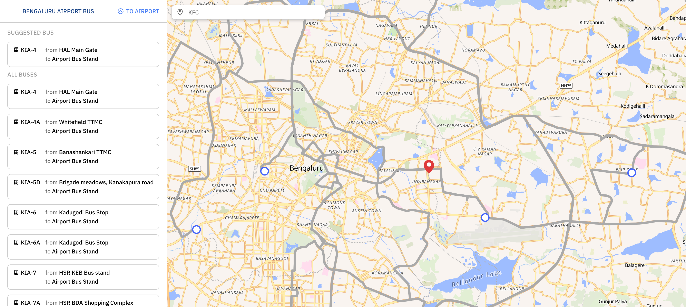

# KIA Bengaluru Airport Bus UI

Source code for the Airport Bus UI at https://kia.bengawalk.com/

For additional help/information, please join the [Discord chat](https://discord.gg/XhmvDP4kXp)



## Local development

In the repository root, run:

```bash
yarn install
yarn start
```

The site is served by a Cloudflare Worker (`worker/index.js`) which also proxies the Google Places and Geocoding APIs used by search, so the API key never reaches the browser. For search to work locally, copy `.dev.vars.example` to `.dev.vars`, add a Google API key with Places API (New) and Geocoding API enabled, and run the worker alongside the dev server:

```bash
yarn start:worker
```

`yarn start` proxies `/api` requests to the worker on port 8787.

## Deployment

Pushes to `main` build the site and deploy it with `wrangler deploy` (`.github/workflows/deploy.yml`). The Google API key is a Worker secret, set once with `npx wrangler secret put GOOGLE_MAPS_API_KEY`.

## Bus data

Timings, intermediate stops and route lines (`src/utils/timings.tsv`, `stops.json`, `routelines.json`) are generated from the BMTC GTFS feed at [Vonter/bmtc-gtfs](https://github.com/Vonter/bmtc-gtfs). `.github/workflows/update-data.yml` regenerates them every 3 days, and commits and deploys when anything changed. To regenerate locally, run:

```bash
yarn data:update
```

Don't edit the generated files by hand. The next update overwrites them.

#### Add a new route

- Add an entry to `BUS_DATA` in `src/utils/constants.js`. The `routename` is `<route> UP` for trips to the airport and `<route> DOWN` for trips from the airport
- The route shows up in the app once the feed has data for it
